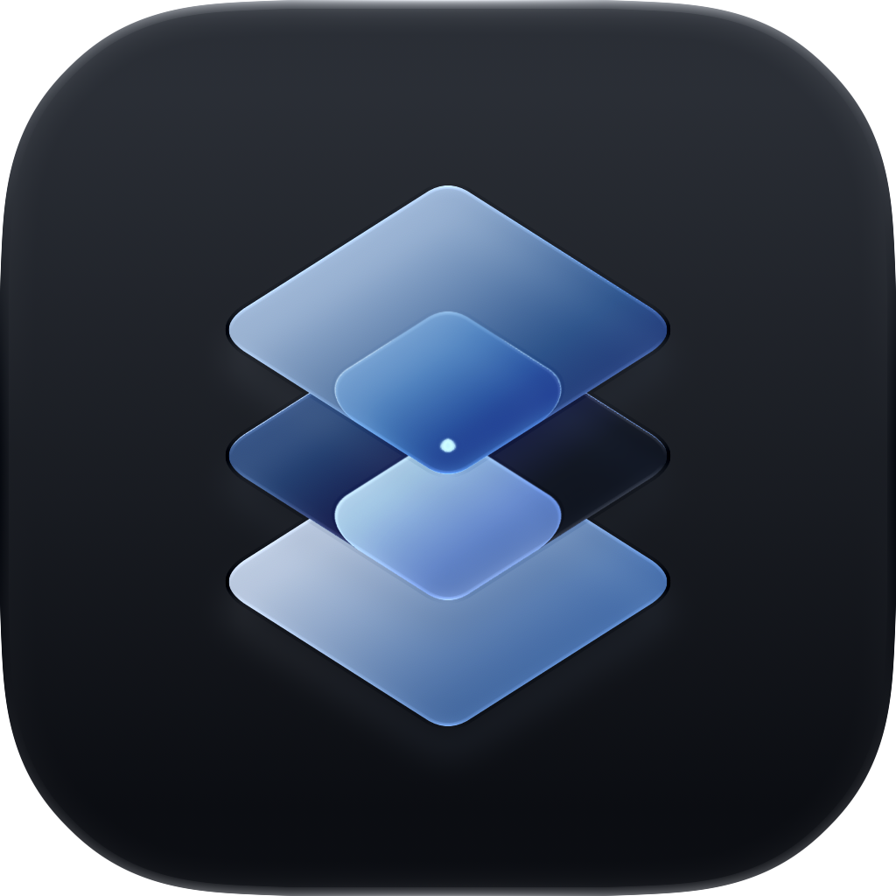

<h1 align="center">Mulg</h1>

Play compatible iPhone and iPad games on Apple silicon Macs.

  <a href="BUILD.md">Build from source</a> ·
  <a href="https://github.com/k-war-meltdown/Mulg/issues/new?template=bug-report.yml">Report a bug</a>

## Features

- **True 4K rendering** at 3840 × 2160 in compatible games, with 5K output and HDR where supported.
- **Up to 120 FPS** in supported titles, with frame pacing, shader caching, and optional MetalFX upscaling.
- **Custom controls** for keyboard, mouse, and controllers, with an in-game mapping editor.
- **Local game library** with IPA import, external-drive storage, and built-in diagnostics.

## Tested games

Genshin Impact · Honkai: Star Rail · BLEACH: Soul Resonance

## License

[GPL-3.0 host](Host/LICENSE) · [AGPL-3.0 PlayTools-derived modules](Runtime/LICENSE) · [Upstream credits](CREDITS.md)
